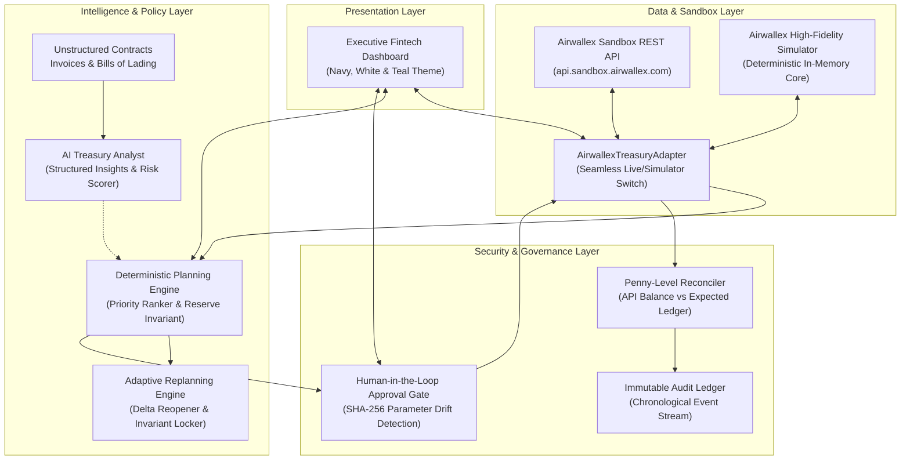

# SpendSmart AI — Airwallex Adaptive Treasury Controller

> **Airwallex Agentic Banking Hackathon Submission**  
> *Starter Kit #01: Adaptive Treasury Controller (Treasury & Ops)*  
> Built strictly adhering to the [Official Airwallex Builder Guide](https://airwallexdev.com/guide).

---

## 🏆 Executive Summary & The Problem

A high-growth global business faces **five operational obligations** due across **three currencies (USD, EUR, GBP)** within **72 hours**. Available funds across wallets are insufficient to satisfy all five obligations while strictly preserving the mandatory **minimum reserve floor ($10,000.00 USD)**.

Generic expense trackers fail here because treasury requires **real decision-making**:
- Which obligations must be paid immediately to prevent operational shutdown?
- Which obligations can be funded locally vs. requiring foreign exchange (FX) conversion?
- What are the explicit corridor fees (e.g. flat **€12.85 EUR** SWIFT fee per transfer)?
- Which obligation is the cheapest to defer without catastrophic consequences?
- When a late customer receivable deposit (**+$35,000 USD**) arrives, how does the agent recalculate the plan and reopen **only** the decisions affected by the new information?

### The Core Architectural Tenet

$$\text{Model Interprets Evidence} \longrightarrow \text{Deterministic Code Decides} \longrightarrow \text{Verified API Executes} \longrightarrow \text{Reconciliation Audits}$$

1. **The Model Interprets Evidence**: Reads unstructured invoices, Bills of Lading, master services agreements, and email threads to score confidence and identify consequences.
2. **Deterministic Code Makes Financial Decisions**: Safe decimal arithmetic (`Decimal.js`), strict reserve floor invariants, FX conversion math, and corridor fees are calculated in code—never delegated to an LLM.
3. **The Verified API Executes Approved Actions**: Live Airwallex Sandbox REST API calls with unique UUID request IDs, transfer lifecycle management (`NEW` $\to$ `SENT` $\to$ `PAID`), and cryptographic human approval binding.
4. **Reconciliation Confirms the Outcome**: Verified API balance reads, penny-level ledger matching, and immutable chronological audit logging.

---

## 📐 System Architecture



---

## 💼 The 5 Fictional Obligations Scenario

| ID | Counterparty | Currency & Amount | Deadline | Criticality | Corridor & Fee | Operational Consequence & Evidence |
| :--- | :--- | :--- | :---: | :---: | :---: | :--- |
| **OBL-001** | Apex Global Logistics & Freight | **$18,500.00 USD** | 12h | `CRITICAL` | US LOCAL (Free) | Port demurrage ($2,000/day) & customs freeze on container vessel cargo. *Bill of Lading #BOL-9921.* |
| **OBL-002** | European Cloud Infrastructure AG | **€14,200.00 EUR** | 24h | `HIGH` | DE SWIFT (+€12.85) | Primary cloud database throttled & 5% contract penalty. *Invoice #INV-2026-EU-402.* |
| **OBL-003** | Apex Silicon IP Licensing Ltd | **£9,800.00 GBP** | 36h | `MEDIUM` | UK LOCAL (Free) | Chip tape-out RTL license warning; vendor permits 48h cure window. *Milestone Agreement #LIC-4410.* |
| **OBL-004** | Delta Advanced Materials Inc | **$22,000.00 USD** | 48h | `MEDIUM` | US LOCAL (Free) | Bulk materials supplier allows 14-day deferral for 1.2% fee ($264). **Cheapest candidate for deferral!** |
| **OBL-005** | Horizon Global Media Group | **€11,500.00 EUR** | 60h | `LOW` | FR SWIFT (+€12.85) | Q4 marketing campaign retainer. Zero operational fulfillment impact if deferred 30 days. |

### Initial Balances & Reserve Policy
- **Available USD Balance**: **$42,000.00 USD**
- **Available EUR Balance**: **€4,000.00 EUR**
- **Available GBP Balance**: **£1,500.00 GBP**
- **Minimum Reserve Floor**: **$10,000.00 USD** (Strict invariant: free USD cash must not drop below this)
- **Net Spendable Initial Buffer**: $42,000 - $10,000 = **$32,000.00 USD**

### Initial Plan Decision
1. **Fund OBL-001** ($18,500 USD): Operations-stopping. Spendable buffer drops to $13,500 USD.
2. **Convert & Fund OBL-002** (€10,212.85 EUR converted at 1.0877 = $11,108.52 USD): High priority cloud hosting. Spendable buffer drops to **$2,391.48 USD**.
3. **Defer OBL-004** ($22,000 USD): Funding would breach reserve floor by $19,608. Deferral fee is only $264.
4. **Defer OBL-003 & OBL-005**: Insufficient buffer; non-critical.

### The Adaptive Event: Inbound Deposit Arrival
- Customer wire arrives: **+$35,000.00 USD** (`POST /simulation/deposit/create`).
- Fresh balances fetched from verified API (not assumed!).
- **Adaptive Delta**:
  - `OBL-001` and `OBL-002` remain **LOCKED** (past finalized actions are never reopened).
  - `OBL-004` (Delta Materials) is **REOPENED** from `DEFER` $\to$ `FUND` with newly freed liquidity.
  - Final reconciliation confirms all balances match expected ledger to the penny!

---

## ⚡ Quick Start & Reproducible Setup

### 1. Prerequisites
- **Node.js**: v18.0.0 or higher (Tested on v24)
- **npm** or **pnpm**

### 2. Installation
```bash
git clone https://github.com/your-username/spendsmart-treasury-controller.git
cd spendsmart-treasury-controller
npm install
```

### 3. Configure Environment Variables
Copy the example environment file:
```bash
cp .env.example .env
```
Edit `.env` (optional, simulator works out-of-the-box):
```env
# Optional Airwallex Sandbox API Credentials
AWX_CLIENT_ID=your_sandbox_client_id_here
AWX_API_KEY=your_sandbox_api_key_here
AIRWALLEX_API_URL=https://api.sandbox.airwallex.com

# Mode: "simulator" (deterministic offline demo) or "sandbox" (live sandbox API)
AIRWALLEX_MODE=simulator
```

### 4. Run Automated Test Suite
Run the 11 comprehensive unit and integration tests:
```bash
npm test
# Or with tsx:
npx tsx --test test/treasury.test.ts
```

### 5. Launch the Dashboard
```bash
npm run dev
```
Open **[http://localhost:3000](http://localhost:3000)** in your browser.

---

## 🎬 Judging Demo Script (7-Step Walkthrough)

| Step | Action on UI | Underlying Agent & Engine Operations | Verified Outcome |
| :---: | :--- | :--- | :--- |
| **1** | Click **"Reset Demo"** | Restores pristine scenario baseline: $42,000 USD, €4,000 EUR, £1,500 GBP, $10,000 reserve floor. | Baseline state loaded. |
| **2** | Click **"1. Generate Initial Plan"** | Deterministic planner ranks 5 obligations, evaluates cash, identifies shortfall. AI Analyst cites Bills of Lading and contracts. | Plan generated: Funds Logistics ($18.5k), converts USD to EUR for Cloud (€10.2k deficit + €12.85 SWIFT fee), defers Materials ($22k). |
| **3** | Click **"2. Execute Payouts"** | Approval gate verifies hash; Airwallex client books FX conversion (`SETTLED`) and executes transfers (`NEW` $\to$ `SENT` $\to$ `PAID`). | OBL-001 & OBL-002 marked Paid. USD wallet balance decreases to $12,391.48 (preserving $10,000 floor). |
| **4** | Inspect **"Reconciliation" Tab** | Queries live API balances and compares against expected ledger. | 100% matched, zero discrepancies. Reserve floor invariant protected. |
| **5** | Click **"3. Receive Deposit"** | Simulates +$35,000 USD inbound wire via `POST /simulation/deposit/create`. Reads live API balances. | Available USD increases to $47,391.48. |
| **6** | Inspect **"Plan Comparison" Tab** | Adaptive reconciler compares plans: Locks executed items (OB-001, OB-002), reopens OB-004 from `DEFER` to `FUND`. | Exact delta table displayed with clear financial justification. |
| **7** | Click **"4. Fund Reopened"** | Executes newly unlocked payout to Delta Advanced Materials ($22,000 USD). | Final reconciliation verified; $15,391.48 USD buffer remains safely above $10,000 floor. |

---

## 🛡️ Safety & Governance Rules Enforced in Code

1. **Reserve Floor Invariant**: Deterministic planner blocks any payout or conversion that would leave the USD wallet below the configured floor ($10,000.00 USD).
2. **Cryptographic Approval Parameter Binding**: Every human approval records a SHA-256 hash of the exact parameters (`obligationId`, `targetAmount`, `targetCurrency`, `sourceAmount`, `fee`). If exchange rates drift or amounts are altered, approval is automatically invalidated.
3. **Idempotency & Request ID Discipline**: Every financial call generates a distinct UUID. Reusing an ID for a different operation within 7 days is rejected with Airwallex error `duplicate_request_id`.
4. **Verified Status Transitions**: Transfers are tracked across intermediate states (`NEW` $\to$ `SENT` $\to$ `PAID` or `CANCELLED`). An incident is never closed until final settlement is confirmed.
5. **No Hallucinated Monetary Calculations**: LLMs only evaluate unstructured context; all balance arithmetic uses `Decimal.js` fixed-point math.

---

## 🧪 Test Coverage Summary

Our automated test suite (`test/treasury.test.ts`) verifies:
- `Decimal-safe currency math avoids floating point imprecision`
- `Deterministic planner enforces strict reserve floor protection`
- `Ranks critical obligations first and defers cheaper non-critical obligation`
- `Escalates when a critical obligation cannot be satisfied without breaching reserve floor`
- `Adaptive replan reopens only affected decisions after deposit arrives`
- `Approval Gate invalidates approval if parameters change (Parameter Drift)`
- `Airwallex Sandbox Simulator enforces idempotency and duplicate request ID rejection`
- `Airwallex Sandbox Simulator blocks transfers exceeding available funds`
- `Treasury Reconciler detects balance discrepancies and reserve floor breaches`
- `Transfer failure transitions correctly and records failure_type (BANK_RETURN)`
- `FX conversions include flat SWIFT fee (€12.85) and settle immediately`

---

## 🔮 Future Roadmap & Limitations

- **Multi-Tenant Connected Accounts**: Expanding from single-entity treasury to platform multi-employer payroll (Starter Kit #06) using `x-on-behalf-of`.
- **Dynamic Forward Contracts**: Hedging volatile foreign obligations with multi-day FX forward contracts.
- **Automated ERP Webhook Integration**: Direct bidirectional sync with NetSuite, SAP, and QuickBooks.

---

## 📄 License
MIT License. Built for the Airwallex Agentic Banking Hackathon 2026.
